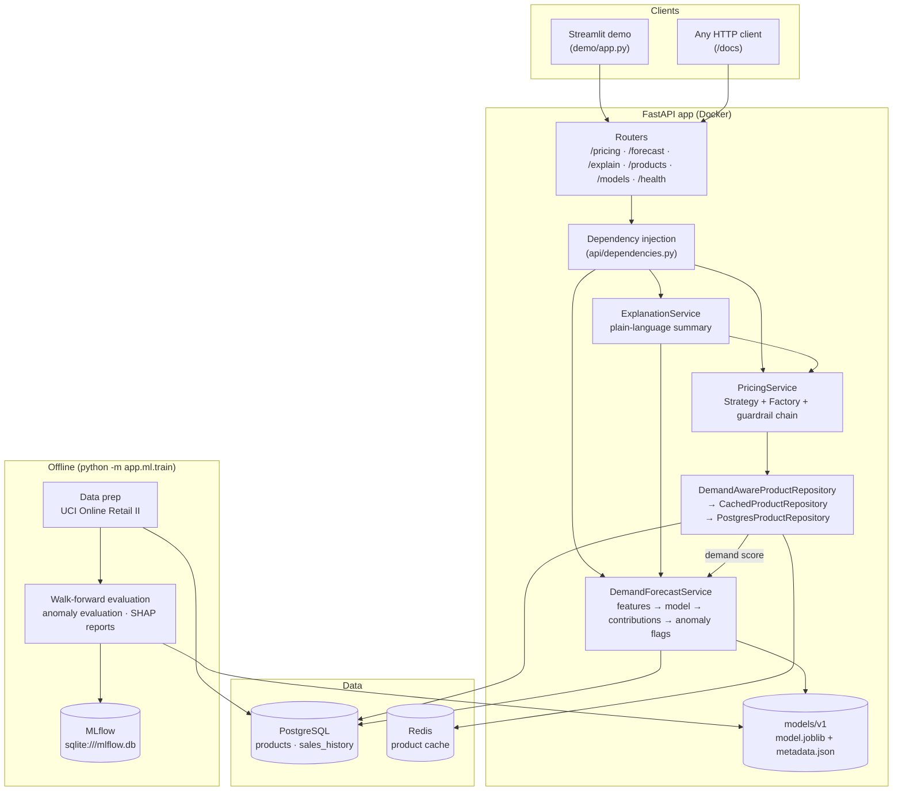
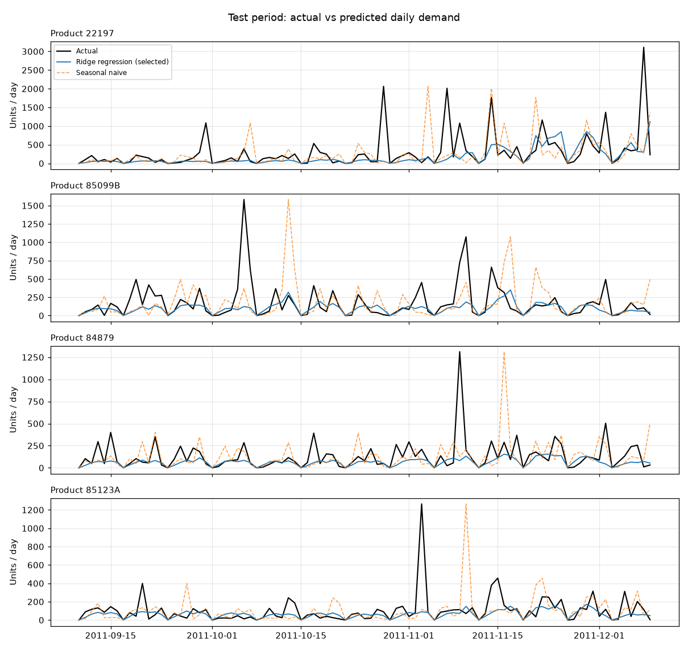

# SmartPrice

**A FastAPI backend that forecasts next-day product demand from real retail data, explains every forecast feature by feature, and turns it into a guardrailed, explainable price.**

> **Live demo:** `<add your Render demo URL here>` · **API docs:** `<add your Render API URL>/docs` · **Demo video:** `<add your video link here>`

Built on the real **UCI Online Retail II** dataset (1,067,371 transactions of a UK gift wholesaler, Dec 2009 – Dec 2011). PostgreSQL stores the catalog and sales history, Redis caches products, MLflow tracks every training run, and a Streamlit page lets anyone click through a forecast and its explanation.

---

## Results at a glance

All numbers come from running the code in this repository (`python -m app.ml.train`, `pytest --cov=app`).

| | |
|---|---|
| Demand forecast (held-out last 91 days) | **WAPE 0.706** vs 0.990 for the seasonal-naive baseline — **28.7% lower error** |
| Model selection | 5 models, **walk-forward validation** (5 folds × 60 days); test set scored once, after selection |
| Anomaly detection (labelled test set) | **F1 0.476** (precision 0.395, recall 0.600) — best of 4 detectors |
| Explainability | per-feature contributions that add up to the prediction **exactly** (within 1e-14) |
| Tests | **522 passing**, **94% line coverage**; leakage, training/serving parity and Redis-outage tests included |
| Production image | runs at **151 MiB RAM**; a fresh database is migrated and seeded on first boot |

---

## Architecture



**How the model reaches the price without touching the pricing core:** a repository decorator (`DemandAwareProductRepository`) fills each product's `demand_score` from the live forecast. `PricingService`, the strategies and the guardrails still receive a plain `Product`. The `demand_based` strategy prices at `competitor × (0.90 + 0.20 × demand_score)` — at most ±10%, and the cost-floor and volatility guardrails still run afterwards.

---

## The ML approach

### Data
- **UCI Online Retail II** — real transactions; raw 1,067,371 rows → **1,002,004** after removing 34,335 duplicate rows (the two Excel sheets overlap), cancellations, returns, free items and postage/fee lines.
- The **20 products sold on the most distinct days** (559–603 of 604 trading days), turned into **14,780** product-days (20 × 739 calendar days). **22%** of product-days have zero sales: the shop is closed on Saturdays, bank holidays and over Christmas.
- The processed data is versioned by its **SHA-256**, logged with every training run.
- **Documented assumptions:** the dataset has no costs or competitor prices. Competitor price = the product's median selling price; cost = 60% of it. The demand data the model learns from is entirely real.

### Forecasting (next-day units per product)
- **Leakage-safe features:** lags (1, 7, 14 days), rolling means and standard deviations over 7 and 28 days computed on `.shift(1)`, weekday, month, English bank holidays, the Christmas closure, and the last price paid *before* the forecast day. Tests change every future value and assert past features are identical.
- **Evaluation in time order:** the last 91 days are held out; model selection uses walk-forward validation (`TimeSeriesSplit` on dates) — never a random split, which would train on the future.
- **Candidates:** naive (yesterday), seasonal naive (same weekday last week), 7-day moving average, Ridge regression, LightGBM. Both learned models are trained on `log1p(units)` because demand is heavy-tailed.
- **Metrics:** MAE, RMSE and **WAPE** — chosen over MAPE because MAPE divides by zero on zero-sale days.

### Anomaly detection
- No labels exist, so labelled spikes, drops and flatlines are **injected** into real held-out data (seeded).
- Four detectors compared: rolling z-score, IQR fences, Isolation Forest, and z-score + a repeated-value rule.
- Each threshold is chosen for best F1 on a **validation** window, then frozen and scored once on a separate **test** window.

### Explainability
- **Per forecast (API):** exact contributions — coefficient × value for the deployed Ridge model, TreeSHAP (`pred_contrib`) for LightGBM — translated into sentences such as *"Month: December — lowers the forecast ×0.67"*.
- **Global (reports):** mean |contribution| for both models side by side, plus a SHAP summary plot for LightGBM.

### MLOps
- `python -m app.ml.train` evaluates, refits the selected model on all data, saves an **immutable** `models/vN/` (model + metadata: features, dataset hash, metrics, library versions, MLflow run id) and logs parameters, metrics, the feature list, reports and the model to **MLflow** (local SQLite store, no server).
- The API loads the version named in `MODEL_VERSION` — deploying or rolling back is a config change.

---

## Results

### Demand forecast — walk-forward validation (used to choose the model)

| Model | MAE | RMSE | WAPE (mean ± std over 5 folds) |
|---|---:|---:|---:|
| Naive (yesterday) | 68.55 | 182.14 | 1.238 ± 0.053 |
| Seasonal naive (same weekday last week) | 64.59 | 181.78 | 1.164 ± 0.029 |
| Moving average (last 7 days) | 58.04 | 138.95 | 1.049 ± 0.045 |
| **Ridge regression (selected)** | **42.43** | 132.75 | **0.763 ± 0.029** |
| LightGBM | 42.45 | 129.83 | 0.767 ± 0.033 |

### Demand forecast — held-out test set (10 Sep – 9 Dec 2011, scored once)

| Model | MAE | RMSE | WAPE |
|---|---:|---:|---:|
| Naive (yesterday) | 84.54 | 208.15 | 1.177 |
| Seasonal naive (same weekday last week) | 71.09 | 182.88 | 0.990 |
| Moving average (last 7 days) | 66.65 | 154.80 | 0.928 |
| **Ridge regression (selected)** | **50.68** | 151.42 | **0.706** |
| LightGBM | 50.59 | 151.77 | 0.705 |

**Why Ridge?** It tied with LightGBM — 0.004 apart in validation WAPE, well inside the fold-to-fold spread (~0.03) — and the pre-set rule picks the lowest mean validation WAPE. On a tie, the simpler, faster, exactly-explainable model is the better engineering choice.



### Anomaly detection — test window (1,560 open product-days; 30 spikes, 30 drops, 15 flatline days injected)

| Detector | Threshold | Precision | Recall | F1 | Spike recall | Drop recall | Flatline recall |
|---|---:|---:|---:|---:|---:|---:|---:|
| Rolling z-score | \|z\| ≥ 2.019 | 0.364 | 0.520 | 0.429 | 0.43 | 0.77 | 0.20 |
| IQR fences | 1.539 IQR | 0.317 | 0.427 | 0.364 | 0.27 | 0.67 | 0.27 |
| Isolation Forest | 0.556 | 0.311 | 0.560 | 0.400 | **0.53** | **0.80** | 0.13 |
| **Rolling z-score + repeated-value rule** | \|z\| ≥ 2.019 | **0.395** | **0.600** | **0.476** | 0.43 | 0.77 | **0.60** |

Precision is a lower bound: the real data contains natural extreme days (bulk orders) with no label, so flagging one counts as a false positive.

### Global feature importance (mean |contribution|, log scale, 14,220 rows)

| Feature | Ridge (deployed) | LightGBM |
|---|---:|---:|
| `day_of_week` | 0.845 | 0.513 |
| `roll_mean_28` | 0.279 | 0.308 |
| `product_id` | 0.196 | 0.154 |
| `lag_7` | 0.029 | 0.404 |

Both models are driven mainly by the weekday (the shop is closed on Saturdays) and the product's recent level. LightGBM additionally uses "zero sales on the same weekday last week" as a proxy for a closed day — the same knowledge, encoded differently. Full tables: [`reports/`](reports/).

### Honest limitations
- **WAPE ~0.7 is still high.** A wholesaler's demand is dominated by one-off bulk orders (single days of 1,000–3,000 units against a typical 25–120); no history-based feature can see them coming.
- **The model is systematically cautious** (it predicts ~58% of total test volume) — the cost of a log target optimised for WAPE. The demand score compares the forecast with the model's *own* forecasts for the same weekday, so the bias cancels out.
- Costs and competitor prices are documented assumptions, not data.

---

## API

| Method | Path | What it returns |
|---|---|---|
| `POST` | `/api/v1/pricing/` | price for `{product_id, strategy}` — strategies: `competitive`, `cost_plus`, `dynamic`, `penetration`, `demand_based` |
| `GET` | `/api/v1/forecast/{product_id}` | next-open-day forecast, demand score, top 5 factors, recent anomaly flags |
| `GET` | `/api/v1/explain/{product_id}?strategy=demand_based` | why this forecast and why this price, in plain language and numbers |
| `GET` | `/api/v1/products/` | the catalog |
| `GET` | `/api/v1/models/current` | served model version, dataset hash, validation and test metrics |
| `GET` | `/health` | app, database, cache and model status |

Errors share one shape — `{"detail": "...", "code": "product_not_found"}` — with 404 (unknown product), 422 (no sales history), 503 (no model loaded). Redis and the model are optional at runtime: without them, pricing still works.

---

## Run it locally

Requirements: Python 3.12 and Docker.

```bash
pip install -r requirements-dev.txt         # API + training + tests (requirements.txt = API only)
cp .env.example .env                        # then set a real POSTGRES_PASSWORD (and DATABASE_URL)

docker compose up -d                        # PostgreSQL 17 + Redis 7
alembic upgrade head                        # schema
python -m app.database.seed                 # 23 products + 14,780 days of sales (idempotent)

python -m uvicorn app.main:app --reload     # API on http://127.0.0.1:8000  (docs: /docs)
streamlit run demo/app.py                   # demo on http://localhost:8501
```

Or run the API exactly as it is deployed: `docker compose --profile app up -d --build` (port 8080).

### Rebuild the data and retrain

```bash
# Raw data (45.6 MB, not committed): https://archive.ics.uci.edu/static/public/502/online+retail+ii.zip
# -> save as data/raw/online_retail_ii.zip
python -m app.ml.data.prepare               # -> data/processed/ (committed, hashed)
python -m app.ml.train                      # evaluate, version (models/vN), track in MLflow, write reports/
mlflow ui --backend-store-uri sqlite:///mlflow.db
```

### Tests

```bash
pytest                                      # 522 tests; PostgreSQL/Redis tests skip if those are not running
pytest --cov=app --cov-report=term          # 94% line coverage
```

Highlights: leakage tests (change the future, past features must not move), a **training/serving parity** test (the live service and the offline pipeline must produce the same forecast), API route and field contracts, Redis-outage tests across every endpoint, and architecture tests (the business layer never imports FastAPI, SQLAlchemy or Redis; the API never imports training tools).

---

## Deploy (free tiers)

**Render** (2 web services from `render.yaml`) + **Neon** or **Supabase** (PostgreSQL) + **Upstash** (Redis).

1. **Neon**: create a project and copy the **direct** connection string (host without `-pooler`). Paste it as-is — the app converts `postgresql://...?sslmode=require` to its async driver's format itself.
2. **Upstash**: create a Redis database and copy its `rediss://default:<token>@<name>.upstash.io:6379` URL.
3. Push this repository to GitHub (`.env` is git-ignored — check it is not committed).
4. **Render → New → Blueprint** → choose the repository. Render creates `smartprice-api` (Docker) and `smartprice-demo` (Python).
5. Enter `DATABASE_URL` and `REDIS_URL` when asked.
6. Wait for the API to go live — its first boot runs the migrations and loads the demo data. Copy its URL.
7. Set `SMARTPRICE_API_URL` on `smartprice-demo` to that URL.
8. Check `https://<api>/health`, then open the demo.

Free services sleep when idle; the first request after a pause can take up to about a minute.

---

## Project structure

```
app/
├── api/            routers, dependency injection (composition root), exception handlers
├── services/       PricingService, DemandForecastService, ExplanationService
├── strategies/     5 pricing strategies (Strategy pattern) + factories/ (Factory pattern)
├── guardrails/     cost floor and volatility cap (Chain of Responsibility)
├── repositories/   Postgres / cached (Redis) / demand-aware / in-memory (Repository + Decorator)
├── models/         domain model: Product, PriceQuote, DemandForecast
├── ml/             data prep, features, metrics, forecasting, anomaly detection, explainability,
│                   model store, training pipeline
├── database/       SQLAlchemy models, session, seed     cache/  Redis client and product cache
└── main.py
alembic/            3 migrations          models/v1/   the deployed model
data/processed/     versioned dataset     reports/     generated results tables and plots
demo/app.py         Streamlit demo        tests/       522 tests
Dockerfile · docker-compose.yml · render.yaml · scripts/start.sh
```

**Design patterns:** Strategy, Factory, Chain of Responsibility (+ Template Method), Repository, Decorator (×2: cache, demand score), Dependency Injection, Cache-Aside — each introduced and justified in the [DEVLOG](DEVLOG.md).

---

## Documentation

- **[DEVLOG.md](DEVLOG.md)** — a day-by-day engineering log: every design decision, every bug found and how, real outputs, and interview Q&A for each day.
- **[reports/](reports/)** — generated forecast and anomaly comparisons, feature importance, SHAP summary.

**Tech stack:** Python 3.12 · FastAPI · Pydantic · PostgreSQL 17 · SQLAlchemy 2 (async) · Alembic · Redis 7 · scikit-learn · LightGBM · SHAP · MLflow · pandas · Streamlit · Docker · pytest
