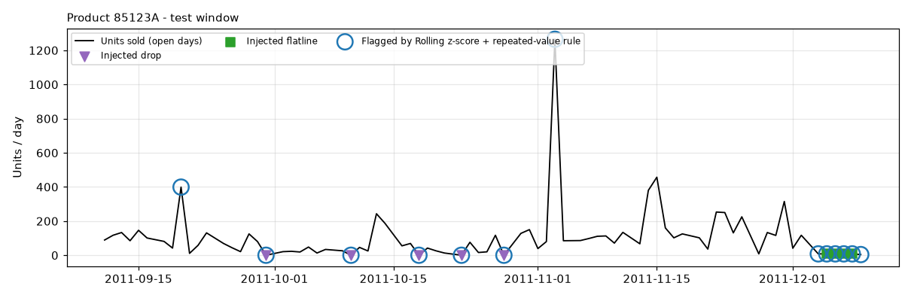

# Anomaly Detection Comparison

Generated by `python -m app.ml.anomaly.evaluate` from real data (UCI Online Retail II, 20 products) with injected, labelled anomalies. Only open days are judged (Saturdays, bank holidays and the Christmas break are planned closures).

- **Validation window (threshold chosen here):** 2011-06-11 to 2011-09-09 - 1,540 open product-days, injected: 30 spike, 30 drop, 15 flatline
- **Test window (scored once):** 2011-09-10 to 2011-12-09 - 1,560 open product-days, injected: 30 spike, 30 drop, 15 flatline
- **Threshold rule:** the score cut-off with the best F1 on validation, then frozen.
- **Test-set hygiene:** an earlier development run scored a different draw of test anomalies (seed 2); the repeated-value rule was added afterwards, based on validation evidence. These final numbers use a fresh draw (seed 3) that the final design was never tuned on.

## Test results

| Detector | Threshold | Flags | Precision | Recall | F1 | Recall: spike | Recall: drop | Recall: flatline |
|---|---:|---:|---:|---:|---:|---:|---:|---:|
| Rolling z-score | 2.019 | 107 | 0.364 | 0.520 | 0.429 | 0.43 | 0.77 | 0.20 |
| IQR fences | 1.539 | 101 | 0.317 | 0.427 | 0.364 | 0.27 | 0.67 | 0.27 |
| Isolation Forest | 0.556 | 135 | 0.311 | 0.560 | 0.400 | 0.53 | 0.80 | 0.13 |
| Rolling z-score + repeated-value rule **(best)** | 2.019 | 114 | 0.395 | 0.600 | 0.476 | 0.43 | 0.77 | 0.60 |

Thresholds are in each detector's own units: |z| in standard deviations (log scale), IQR fences in interquartile ranges, Isolation Forest in negated `score_samples`.

Precision is a lower bound: the real data contains unlabelled natural extremes (one-off bulk orders); flagging one counts as a false positive here.

