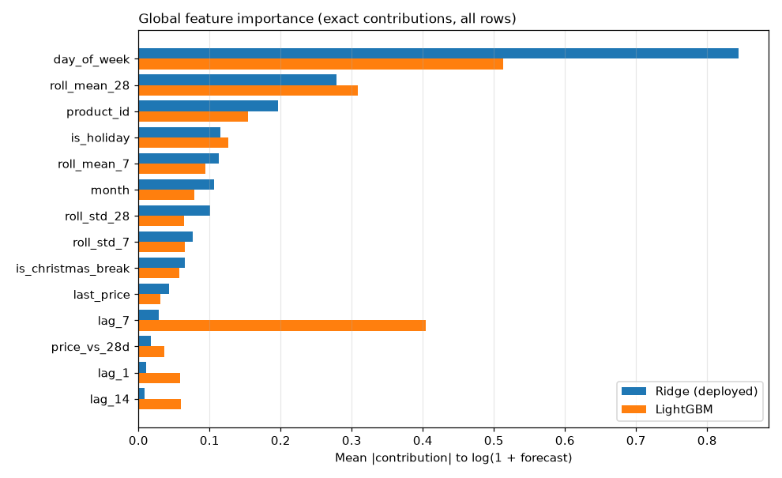
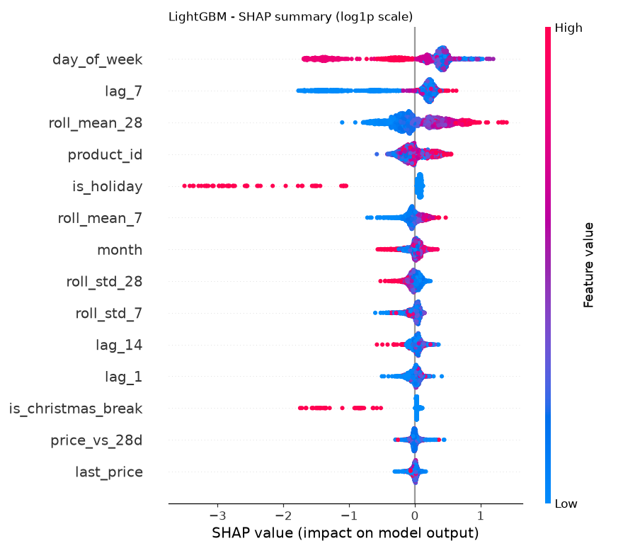

# Explainability

Generated by `python -m app.ml.explain_report`. Global importance = mean |contribution| of each feature to log(1 + forecast), over all 14,220 rows. Ridge contributions are exact (coefficient x value); LightGBM contributions are TreeSHAP values.

| Feature | Ridge (deployed) | LightGBM | LightGBM gain share |
|---|---:|---:|---:|
| `day_of_week` | 0.845 | 0.513 | 19.5% |
| `roll_mean_28` | 0.279 | 0.308 | 10.9% |
| `product_id` | 0.196 | 0.154 | 3.4% |
| `is_holiday` | 0.116 | 0.126 | 7.7% |
| `roll_mean_7` | 0.113 | 0.094 | 3.9% |
| `month` | 0.106 | 0.079 | 2.6% |
| `roll_std_28` | 0.101 | 0.064 | 2.6% |
| `roll_std_7` | 0.076 | 0.065 | 3.0% |
| `is_christmas_break` | 0.065 | 0.057 | 3.2% |
| `last_price` | 0.043 | 0.030 | 1.6% |
| `lag_7` | 0.029 | 0.404 | 32.5% |
| `price_vs_28d` | 0.017 | 0.036 | 2.0% |
| `lag_1` | 0.010 | 0.058 | 3.4% |
| `lag_14` | 0.009 | 0.060 | 3.8% |

- Ridge's top 3: `day_of_week`, `roll_mean_28`, `product_id`
- LightGBM's top 3: `day_of_week`, `lag_7`, `roll_mean_28`

Reading it: a contribution c multiplies (1 + forecast) by exp(c). A mean |contribution| of 0.40 means the feature typically moves the forecast by a factor of about 1.5 up or down.

 - each dot is one product-day (2,000 sampled); position = effect on the forecast, colour = the feature's value (red high, blue low).
