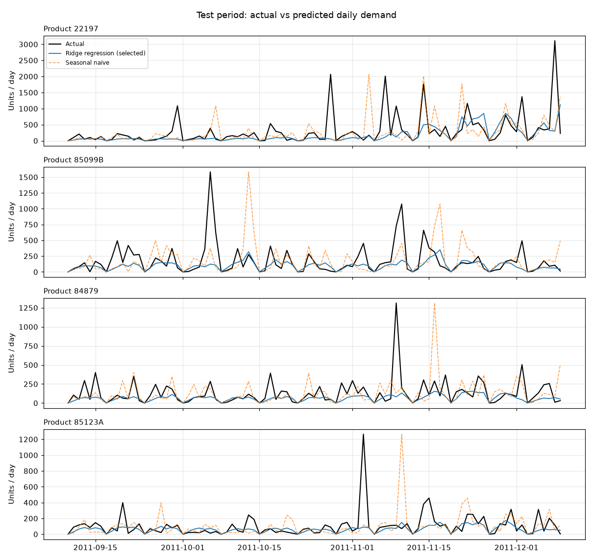

# Forecast Model Comparison

Generated by `python -m app.ml.forecasting.evaluate` from real data (UCI Online Retail II, 20 products). Target: units sold per product per day (next-day forecast).

- **Development period:** 2009-12-29 to 2011-09-09 (12,400 rows)
- **Test period (held out, scored once):** 2011-09-10 to 2011-12-09 (1,820 rows)
- **Model selection:** walk-forward validation, 5 folds x 60 days, lowest mean validation WAPE

## Walk-forward validation (used to choose the model)

| Model | MAE | RMSE | WAPE (mean ± std over folds) |
|---|---:|---:|---:|
| Naive (yesterday) | 68.55 | 182.14 | 1.238 ± 0.053 |
| Seasonal naive (same weekday last week) | 64.59 | 181.78 | 1.164 ± 0.029 |
| Moving average (last 7 days) | 58.04 | 138.95 | 1.049 ± 0.045 |
| Ridge regression **(selected)** | 42.43 | 132.75 | 0.763 ± 0.029 |
| LightGBM | 42.45 | 129.83 | 0.767 ± 0.033 |

## Test set (held out until the end)

| Model | MAE | RMSE | WAPE |
|---|---:|---:|---:|
| Naive (yesterday) | 84.54 | 208.15 | 1.177 |
| Seasonal naive (same weekday last week) | 71.09 | 182.88 | 0.990 |
| Moving average (last 7 days) | 66.65 | 154.80 | 0.928 |
| Ridge regression **(selected)** | 50.68 | 151.42 | 0.706 |
| LightGBM | 50.59 | 151.77 | 0.705 |

**Selected model: Ridge regression.** Test WAPE 0.706 vs. 0.990 for the seasonal-naive baseline (28.7% lower error).

Metrics: MAE and RMSE are in units; WAPE = sum(|error|) / sum(actual demand). WAPE is used instead of MAPE because 22% of product-days have zero sales.

